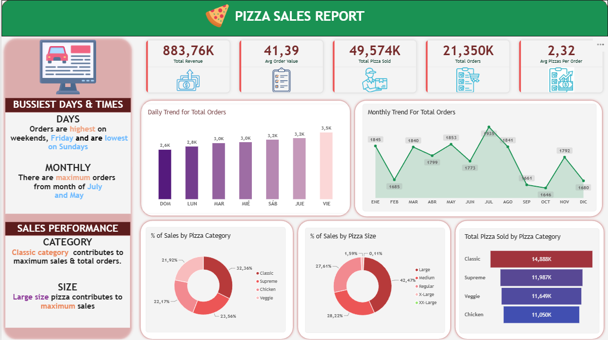

# Pizza Sales: análisis de ventas con SQL Server y Power BI

Análisis de las ventas de una pizzería durante 2015: consultas en **SQL Server** para explorar los datos y un dashboard en **Power BI** para presentar los resultados.

<!-- Sustituye por tu captura del dashboard (guárdala en la carpeta images) -->


## Objetivo

Responder preguntas de negocio sobre ingresos, productos y demanda (qué se vende, cuándo y cuánto) y presentar los hallazgos de forma clara y visual.

## Herramientas

- **SQL Server (Express) y SSMS:** limpieza, consultas y análisis con agregaciones, CTEs y window functions.
- **Power BI:** modelo, medidas DAX y dashboard.

## Los datos

- Tabla única `pizza_sales.csv` con 12 columnas: identificadores de pizza y pedido, cantidad, fecha y hora, precio unitario y total, tamaño, categoría, ingredientes y nombre de la pizza.
- Período: enero a diciembre de 2015. **21,350 pedidos** y **49,574 pizzas vendidas**.

## Cómo reproducirlo

1. En SQL Server, crea una base llamada `PizzaDB` e importa el CSV como la tabla `pizza_sales.csv` (en SSMS: clic derecho sobre la base → *Tasks → Import Flat File*).
2. Ejecuta [`PizzaDB- SQL+PowerBi+Excel/SQLQuery.sql`](PizzaDB- SQL+PowerBi+Excel/SQLQuery.sql). Primero crea la vista `v_pizza_sales`, que convierte cada columna a su tipo correcto (la fecha viene como `dd-mm-yyyy`), y luego contiene todas las consultas.
3. Abre `dashboard/PizzaDB.pbix` con Power BI Desktop.

## Consultas SQL

**Sección A: tutorial.** Ingresos totales, valor promedio del pedido, pizzas vendidas, pedidos, pizzas por pedido, porcentaje por categoría y tamaño, y top y bottom 5 de pizzas por ingresos, cantidad y número de pedidos.

**Sección B: propias.**

| # | Pregunta | Técnica |
|---|---|---|
| B1 | ¿Qué días de la semana tienen más pedidos? (de lunes a domingo) | `CHOOSE`, cálculo de día independiente del idioma del servidor |
| B2 | ¿Cómo evolucionan pedidos e ingresos mes a mes? | Agrupación y orden correcto |
| B3 | ¿A qué horas hay más pedidos? | `DATEPART` |
| B4 | ¿Cuáles son las 3 pizzas con más ingresos por categoría? | CTE y `RANK() OVER (PARTITION BY ...)` |
| B5 | ¿Cuánto crecen los ingresos de un mes a otro? | `LAG` |
| B6 | ¿Cuáles son los ingresos acumulados del año? | `SUM() OVER` |
| B7 | ¿Cuántas pizzas concentran el 80% de los ingresos? | Análisis de Pareto con window functions |
| B8 | ¿Cuál es la hora pico de cada día? | `ROW_NUMBER() OVER (PARTITION BY ...)` |
| B9 | ¿Cuántas pizzas se piden por pedido? | CTE y distribución porcentual |
| B10 | ¿Cuáles son los ingredientes más presentes en lo que se vende? | `STRING_SPLIT` y `CROSS APPLY` |

## Hallazgos del dashboard

| Tema | Hallazgo |
|---|---|
| Indicadores generales | 883.76K de ingresos, 21,350 pedidos, 49,574 pizzas, valor promedio del pedido de 41.39 y 2.32 pizzas por pedido. |
| Días de la semana | El viernes es el día con más pedidos (~3.5K), jueves y sábado le siguen (~3.2K) y el domingo es el más bajo (~2.6K). |
| Meses | Julio tiene más pedidos (1,935) y octubre menos (1,646): julio supera a octubre en cerca de 18%. |
| Categorías | Classic es la categoría líder: 32.36% de las ventas y 14,888 pizzas. Le siguen Supreme (23.56%), Chicken (22.17%) y Veggie (21.92%). |
| Precio por categoría | Chicken vende menos unidades que Veggie (11,050 frente a 11,649) pero genera más ingresos, lo que indica pizzas de mayor precio. |
| Tamaños | La pizza Large aporta el 42.47% de las ventas. XL y XXL juntas son menos del 2%. |

## Limitaciones

- Los datos cubren un solo año, así que no se puede medir crecimiento año a año.
- No hay información de clientes, por lo que no se analiza la recompra.
- El dataset fue modificado respecto al original (ver sección *Los datos*).

## Próximos pasos

- Segunda página del dashboard: mapa de calor por día y hora, curva de Pareto, top 3 por categoría e ingredientes más vendidos.
- Recomendaciones de negocio basadas en los hallazgos (personal en horas pico y revisión de pizzas de bajo rendimiento).
- Ordenar los días de la semana de lunes a domingo en el gráfico de tendencia diaria.

## Estructura del repositorio

```
├── README.md
├── sql/
│   └── pizza_sales_consultas.sql
├── images/
│   └── dashboard-pizza.png
└── dashboard/
    └── pizza_sales.pbix
```

## Autor

**[Tu nombre]** · [LinkedIn](https://www.linkedin.com/) · [Correo]
